<p align="center">
  <a href="https://www.linkedin.com/in/daniellelooo"></a>
  <a href="mailto:daniellelo063@gmail.com"></a>
  <a href="https://www.movo.software"></a>
  <a href="https://www.eternalgrowth.xyz"></a>
</p>

### About me

```js
const daniel = {
  base: "Medellín, Colombia · Systems & Computer Engineering @ UPB",

  shipping: {
    movo: "born in a real body shop that runs on it: 34 users, ~80 cars/month",
    MIND: "digital transformation consulting: software, growth, BI & analytics",
    EternalGrowth: "digital transformation for SMBs: software, automation, BI, ads",
  },

  workflow: "spec → AI agent team (plan, build, test, security) → verified in prod",

  evaluatingAI: [
    "built a blind LLM-as-a-judge that measures its own position bias",
    "caught a model citing a paper that doesn't exist",
  ],

  forFun: {
    gbcEmulator: "a Game Boy Color from scratch, accurate to the pixel",
    centavos75: "a detective story you solve by writing real JavaScript",
    faro: "my Mac's dictation, meeting notes and notch island, all local",
  },
};
```

### Featured projects

| | Project | What it proves |
|---|---|---|
| **AI eval** | [arena-modelos](https://github.com/daniellelooo/arena-modelos) | You can't trust a judge you haven't tested. Answers are scored blind on a 5-criteria rubric and every comparison runs twice with the order swapped: the judge kept its verdict 91% of the time, and the run caught a model inventing a source. |
| **Emulation** | [gbc-emulator](https://github.com/daniellelooo/gbc-emulator) | A full Game Boy Color in TypeScript that runs in the browser and passes the suites emulator authors use: Blargg cpu_instrs 11/11, 66 Mooneye tests, cgb-acid2 pixel for pixel. |
| **Games** | [75-centavos](https://github.com/daniellelooo/75-centavos) | Berkeley, 1986: the lab's books are off by 75 cents. You solve the case in 30 missions by writing JavaScript that runs sandboxed against test cases. [Play it](https://75-centavos.vercel.app) |
| **macOS** | [faro](https://github.com/daniellelooo/faro) | Dictate anywhere on the Mac with Whisper running locally and an LLM cleaning the text; record meetings and get summaries; a dynamic island in the notch. 133 tests. |
| **Systems** | [dfs-upb](https://github.com/daniellelooo/dfs-upb) | An HDFS-style distributed file system in Java: NameNode, DataNodes and a CLI. |

### Tech stack

<p align="center">
  
</p>
<p align="center">
  
  
  
  
  
  
</p>

### GitHub activity






<p align="center"><sub>Medellín, Colombia · open to AI training and evaluation work</sub></p>
